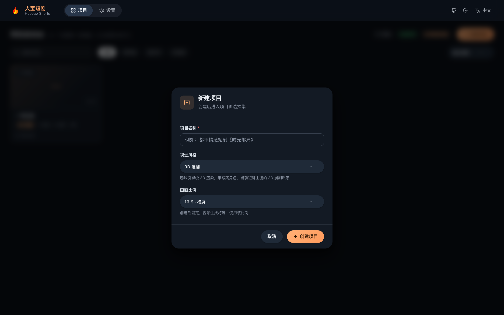
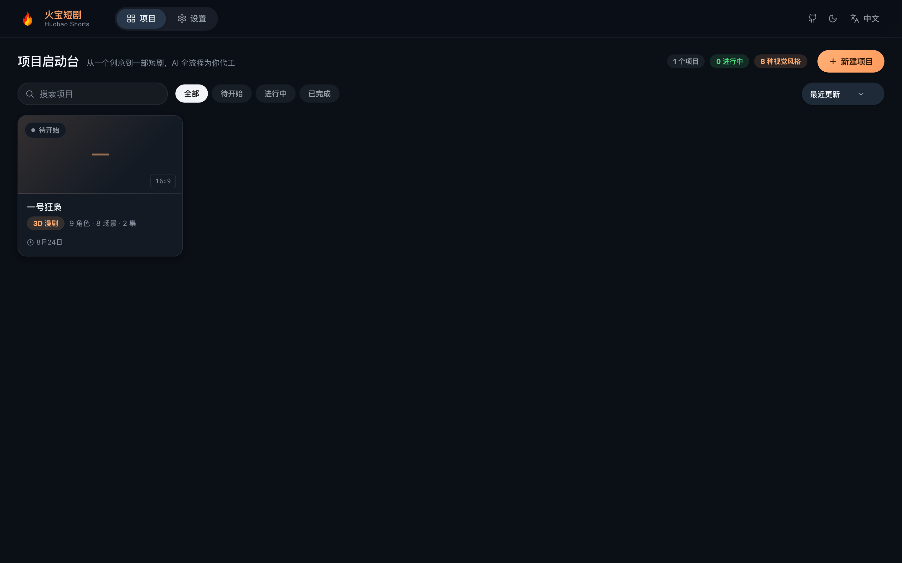
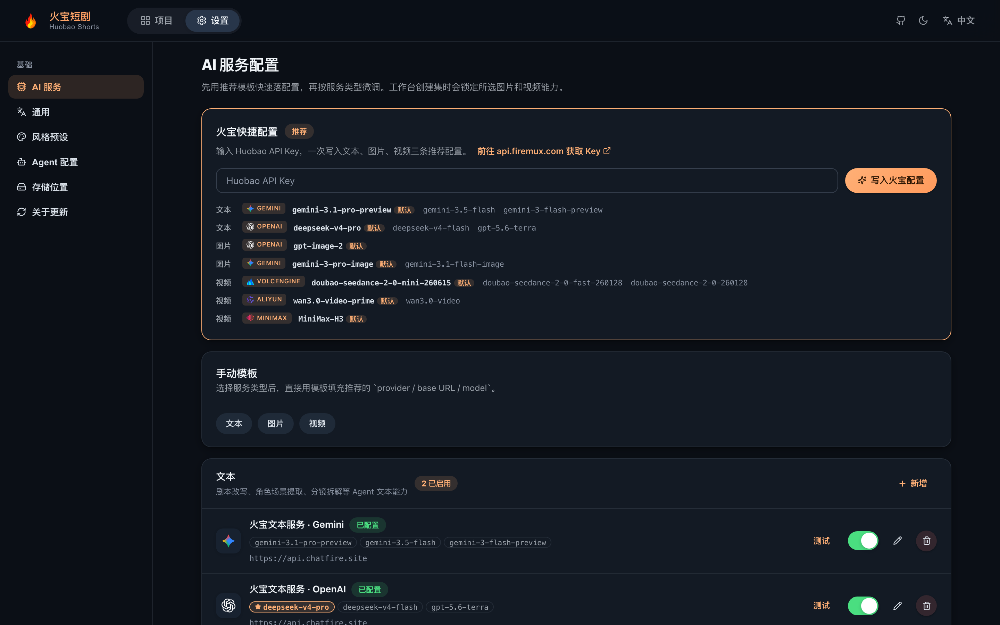
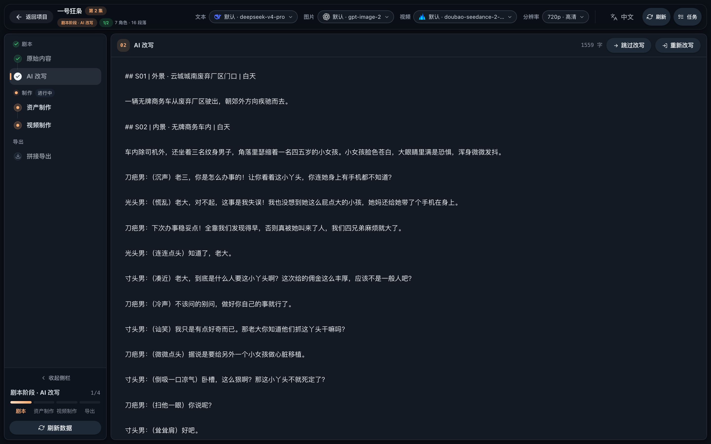
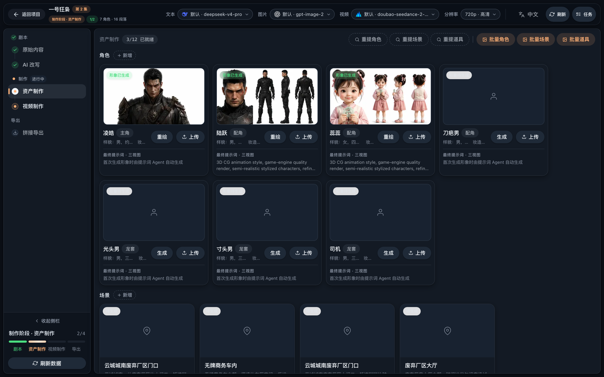
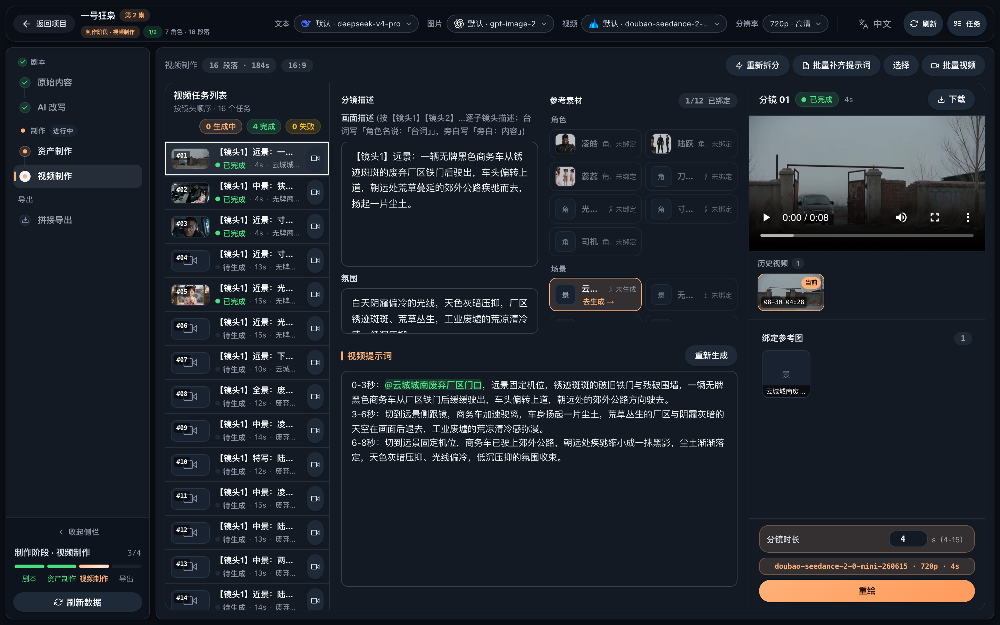
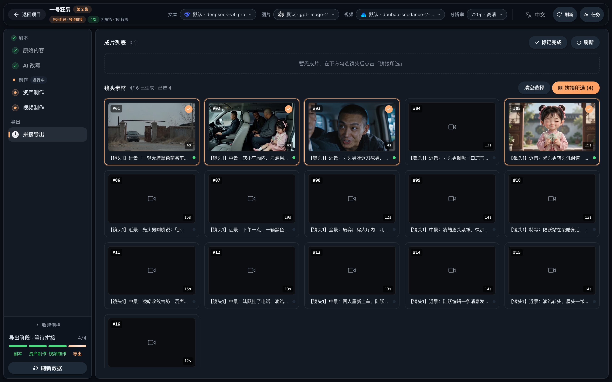
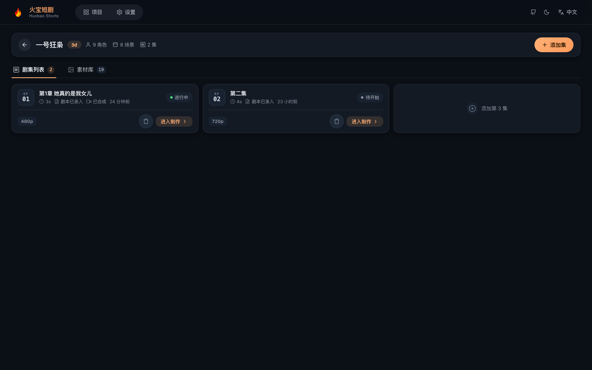

# 🎬 视频工厂 - AI 短剧生成平台

<div align="center">

**基于 TypeScript 全栈的 AI 短剧自动化生产平台**

[](https://nodejs.org)
[](https://react.dev)
[](LICENSE)
[](https://github.com/chatfire-AI/huobao-drama/releases/latest)

[English](README.md) | **简体中文** | [日本語](README.ja.md) | [한국어](README.ko.md)

[功能特性](#-功能特性) • [快速开始](#-快速开始) • [图文教程](#-图文教程) • [桌面版](#-桌面应用推荐) • [部署指南](#-部署指南)

<h2>🔑 <a href="https://api.firemux.cn">获取 Huobao API Key 👉 立即查看</a></h2>

**文本 · 图片 · 视频全部 AI 能力，一个 Key 即可开通**

部署完成后在「设置 → 火宝快捷配置」粘贴 Key，一键写入三条推荐配置，开箱即用

<h3>📥 <a href="https://github.com/chatfire-AI/huobao-drama/releases/latest">上游历史桌面版本（macOS / Windows）</a></h3>
<h3>🌐 <a href="https://www.chatfire.site">官方网站</a></h3>

</div>

---

## 📖 项目简介

视频工厂 是一个基于 AI 的短剧自动化生产平台，实现从剧本生成、角色设计、分镜制作到视频合成的全流程自动化。

### 🎯 核心价值

- **🤖 AI 驱动**：使用大语言模型解析剧本，提取角色、场景和分镜信息
- **🎨 智能创作**：AI 绘图生成角色形象和场景背景
- **📹 视频生成**：基于文生视频和图生视频模型自动生成分镜视频
- **🔄 工作流**：完整的短剧制作工作流，从创意到成片一站式完成

### 🛠️ 技术架构

```
frontend-react/ — React 19 + TypeScript + Vite 7 + Tailwind CSS v4
backend/    — Hono + Drizzle ORM + Mastra AI Agents + better-sqlite3
backend/workspace/skills/ — Agent 技能定义 (SKILL.md，支持界面在线编辑)
desktop/    — Electron 桌面版（主进程 + esbuild 打包 + electron-builder 出 dmg/exe）
data/       — 生成资源文件与 SQLite 数据库
```

---

## ✨ 功能特性

### 统一模型与服务

短剧与创意视频的制作流程独立，模型配置共用「设置 → 模型与服务」和 `ai_service_configs`。支持文本、图片、视频、语音合成、语音识别、口型同步、骨骼绑定、联网资料、联网素材九类能力，各类可配置多个账户，优先级最高的启用配置为默认项。联网资料与素材是外部服务，不是生成模型。短剧 Agent、创意规划、聊天和翻译共用文本模型工厂，统一处理服务商适配、温度、输出上限和兼容接口参数；图片和视频共用生成任务服务。

升级时自动迁移原有创意服务配置，并为此前使用 OpenAI 文本配置的语音功能保留独立的语音配置。之后语音直接使用对应配置中的模型、地址和密钥。密钥不回传浏览器，编辑时留空保留原值；切换服务地址需重新填写密钥。新建的专用服务任务保存配置编号，恢复查询时沿用该配置；删除或停用它后需要恢复配置才能继续。

Sync、Meshy、Tavily、Pexels 当前使用官方地址和预设接口。设置页对这些服务仅检查配置格式，实际认证在执行任务时验证。语音识别目前使用能输出字幕时码的 Whisper，配音模型可单独设置。

### 全部制作工具箱

创意项目中的「制作工具箱」按目录展示本地 OpenMontage 参考版本的全部 **153 个唯一命名工具与素材源项**。参考目录里的 **190 是 Python 文件数量**，包括注册表、协议、鉴权和公共辅助文件；它不是 190 个独立可执行工具。项目使用原生 TypeScript/React 实现，运行时不导入参考项目。

工具箱覆盖本地剪辑与转场、声音处理、字幕、画面增强、图表与数学动画、角色动作、三维场景、录屏、生成模型、数字人、素材检索与交付打包。可以搜索、按类别/服务商筛选，选择项目素材或先前产物作为输入，编辑制作参数，执行后预览、下载并导入素材库或指定镜头。SRT/VTT 及工具生成的 JSON 字幕可写回原片字幕，GLB 可加入三维模型库。

[逐项执行映射与替代说明](backend/docs/production-tool-coverage.json)记录每个参考 ID 的实际执行路径和服务商。原厂入口、统一服务替代和来源页面检索分别标注。Sora 的原 Videos API 已于 2026-09-24 停用，相关入口使用可用视频模型替代；旧 Imagen 入口迁移到 Nano Banana。Gemini Omni 旧直连、Kling TTS、LTX Modal 和 MiniMax 图像使用同能力的共享服务。部分素材网站只提供来源页面检索，不伪造下载链接或许可。

全部服务使用「模型与服务」管理账户、模型和服务参数。Fal、Replicate、Atlas Cloud、Runway、可灵、豆包、腾讯混元以及各语音/素材服务通过实际协议适配。可灵凭据在 API Key 填写 `AccessKey:SecretKey`，腾讯凭据填写 `SecretId:SecretKey`。Google Cloud 音乐服务需要有权限的 OAuth 访问令牌及项目参数。工作流和 Voice ID 等参数放在服务参数 JSON，密钥统一填在 API Key。

ComfyUI 的九个模型入口需要已部署的服务、对应模型/节点及 API 格式工作流；可在统一配置的 `service_options.workflow_json` 保存工作流，并设置提示词、媒体节点映射。工具不会自动安装第三方节点或模型权重。

| 可选本地功能 | 运行条件 |
| --- | --- |
| Blender 场景及视频 | Blender 4.x，设置 `BLENDER_BIN` |
| 背景分割 | rembg CLI 和分割模型，设置 `REMBG_BIN` |
| 人脸跟踪 | OpenCV，设置 `PRODUCTION_PYTHON_BIN` |
| 人脸修复 | GFPGAN、对应权重及 PyTorch，设置 `GFPGAN_ROOT` 和 Python |
| 网页视频/字幕获取 | yt-dlp，设置 `YTDLP_BIN`；视频处理沿用内置 FFmpeg |
| 离线配音 | Piper 及音色模型，设置 `PIPER_BIN`、`PIPER_MODEL` |
| 三维可交互场景 | Three.js 已作为后端与桌面运行依赖；导出含其 MIT 许可的场景包 |

缺少模型配置或运行依赖时，目录会显示不可用原因。任务与远端编号持久保存；恢复查询沿用原配置，未知提交不会自动重复提交。明确选择「重新提交任务」才会发起新请求。停止查询不会撤销服务商已受理的任务。产物通过实际图像解码、音视频探测或模型检查；应用结果仍需当前项目版本匹配，防止覆盖并发修改。

验证包括真实 FFmpeg/Sharp 媒体、Three.js 浏览器渲染、服务协议与鉴权、未知提交恢复、项目隔离、字幕与模型导入。未配置服务密钥时不声称已完成云端付费生成实测。

12 类制作流程已接入自动工具编排。进入创意项目的「制作流程」，在「制作要求 → 自动制作」选定制作方式与服务；未选专用模型的普通图片/视频仍使用统一模型配置。流程会根据已批准的镜头内容选用工具，自动传递真实文件与结构化结果，并将产物写回素材、镜头、字幕、音轨和成片。相同能力的模型是可选替代，不会把所有服务重复运行。

| 流程 | 按需自动执行的制作链 |
| --- | --- |
| 科普解说 | 来源分析、图解/真实公式动画、旁白、字幕、合成与验片 |
| 动态图形 | 批准的图形/角色/三维参数、运动渲染、后期与合成 |
| 角色动画 | 角色规格 → 关节 → 姿势库 → 动作时间轴 → 结构检查 → 视频渲染；三维路径可接绑定模型 |
| 电影感短片 | 资料与镜头规划、选定图像/视频模型、配乐、调色与交付 |
| 纪录片 / 视频文章 | 原片分析、来源检索下载、证据与原稿检索、选段和来源清单 |
| 实拍 + AI 混合 | 实拍分析与裁切、补充画面制作、统一后期、合成 |
| 真人口播 / 访谈 | 原稿识别、选段、静音检测或裁切、声音增强、构图与字幕 |
| 数字人讲解 | 选定数字人/口型服务、真实人物素材和配音、口型成片回填 |
| 软件演示 / 录屏 | 已有录屏分析、步骤选段、留边构图、讲解与字幕；只有明确开启才录制桌面 |
| 播客转视频 | 原声分析与选段、波形/标题画面、字幕和声音处理 |
| 长视频批量切片 | 原片分析与原稿检索、逐段裁切、构图、独立视频与字幕交付 |
| 字幕翻译 / 配音 | 保留真实时码、字幕翻译、配音时长拟合、声音替换和导出 |

流程内每个工具保存输入、依赖、进度、远端编号、产物和回写记录。可以直接在阶段内恢复任务；未知提交必须核对后恢复，不会自动重发。短配音补齐，长配音最多以 1.5 倍语速匹配镜头，超出会暂停；关闭原声不会关闭新配音。静音裁切会使用真实保留区间更新镜头时长，后续字幕重新计时。质检失败阻止交付。Three.js 可通过 Chrome/Chromium 确定性渲染为 MP4（可用 `PRODUCTION_CHROME_BIN` 指定），支持 GLB 自带骨骼动画；Blender 路径仍需本机安装。

缺少服务、模型、真实来源或必要结构参数时，流程会保留已有任务并显示需补充内容。来源页面搜索不会被当作已下载素材，无时码识别只保存原稿；连续讲稿不使用会重排镜头的节拍混剪。已有流程记录保留原定义，新增流程使用第二版工具编排。

接口与迁移依据：[Sora 停用公告](https://developers.openai.com/api/docs/deprecations)、[Imagen 迁移说明](https://ai.google.dev/gemini-api/docs/imagen)、[Fal 队列](https://fal.ai/docs/documentation/model-apis/inference/queue)、[Replicate](https://replicate.com/docs/reference/http)、[ComfyUI](https://docs.comfy.org/development/comfyui-server/comms_routes)。

### 创意视频制作工具

在「设置 → 模型与服务」填写并启用所需服务的 API Key，再进入创意项目的「制作工具」。服务密钥不会回传到浏览器；外部生成任务使用对应服务账户的额度。

| 功能 | 服务与输入 | 项目中的结果 |
| --- | --- | --- |
| 数字人口型 | Sync；人物视频或人物图 + 逐镜头配音（图片使用 sync-3） | 成片下载、预览、替换原镜头，保留配音与字幕 |
| 三维骨骼绑定 | Meshy；不超过 50MB、内嵌纹理的人形 GLB | 绑定 GLB / FBX、可用的基础动作、三维预览与下载 |
| 联网资料 | Tavily；主题或自定义关键词 | 网页摘要与出处进入资料研究 / 创意阶段，供脚本引用与审阅 |
| 联网素材 | Pexels；关键词、图片或视频 | 手动挑选下载，或自动导入 1–3 个候选到原始素材库，保留作者和许可 |

逐镜头配音可在「画面编排」上传，也可在创作需求开启已有的自动配音。自动口型仅处理有旁白或配音的镜头。角色动画的骨骼阶段可指定已上传模型并自动绑定；三维模型文件还需要后续渲染才能成为影片画面。

自动流程选项需保存到项目后生效。任务与产物持久保存，重启可恢复查询；提交结果不明时需从服务商后台核对任务编号，避免重复计费。镜头输入变化后，旧口型成片仍可下载，但不会覆盖新修改。绑定目前面向人形角色；应先在预览中检查肢体、蒙皮和动作。

联网内容和素材须在阶段审阅时核对。原片剪辑、录屏、访谈等流程仍需上传真实原片，联网补充素材不能代替原片。

接口依据：[Sync](https://sync.so/docs/developer-guides/asset-uploads)、[Meshy](https://docs.meshy.ai/en/api/rigging)、[Tavily](https://docs.tavily.com/documentation/api-reference/endpoint/search)、[Pexels](https://www.pexels.com/api/documentation/)。服务适配与流程为本项目实现，不在运行时依赖 references/OpenMontage。

### 🎭 角色管理

- ✅ AI 生成角色形象
- ✅ 批量角色生成
- ✅ 角色图片上传和管理

### 🎬 视频任务

- ✅ AI 自动生成视频任务
- ✅ 场景描述和视频提示词生成
- ✅ 按任务批量生成视频

### 🎥 视频生成

- ✅ 文生视频自动生成
- ✅ FFmpeg 单镜头合成与字幕处理
- ✅ 整集拼接导出

### 📦 资源管理

- ✅ 素材库统一管理
- ✅ 本地存储支持
- ✅ 任务进度追踪

### 🤖 AI Agents

内置 4 个 Mastra Agent，支持数据库配置和 Skill 扩展：

| Agent | 职责 |
|---|---|
| `script_rewriter` | 小说 → 格式化剧本改写 |
| `extractor` | 角色 / 场景 / 道具智能提取与去重 |
| `storyboard_breaker` | 剧本 → 分镜序列拆解 |
| `prompt_generator` | 角色/场景/道具图片提示词 + 分镜视频提示词生成 |

### 🌐 多语言界面

界面内置 **中文 / English / 日本語 / 한국어** 四种语言，并可全局设置 AI 生成内容的语言。

### 🔌 多厂商适配

| 类型 | 支持厂商 |
|---|---|
| **文本** | OpenAI(兼容接口)、Gemini |
| **图片** | OpenAI、Gemini、火山引擎 |
| **视频** | 火山引擎 Seedance 2.0(标准 / Fast / Mini)、MiniMax H3、阿里云百炼 Wan 3.0 (Prime / 标准) |

---

## 🚀 快速开始

### 📋 环境要求

| 软件 | 版本要求 | 说明 |
|---|---|---|
| **Node.js** | 22.12+ | 前后端运行环境 |
| **npm** | 9+ | 包管理工具 |

> **数据库零安装**：内置 SQLite（单文件，随项目数据目录存放），无需安装任何数据库服务。
> **FFmpeg 无需安装**：项目通过 `ffmpeg-static` / `ffprobe-static` npm 包内置二进制，开箱即用。

### ⚙️ 环境变量

无需配置文件，通过环境变量设置（均有默认值，本地开发可零配置启动）：

| 变量 | 默认值 | 说明 |
|---|---|---|
| `SQLITE_PATH` | `<仓库根>/data/huobao.sqlite3` | SQLite 数据库文件位置 |
| `PORT` | `5679` | 后端服务端口 |
| `STORAGE_PATH` | `<仓库根>/data/static` | 生成文件存储目录 |
| `HUOBAO_DATA_DIR` | — | 桌面版由 Electron 主进程注入（userData 数据根） |
| `WORKSPACE_PATH` | `backend/workspace` | Agent 技能/提示词目录（桌面版指向 userData 可写副本） |
| `FRONTEND_DIST` | `frontend-react/dist` | 前端静态产物目录 |
| `FFMPEG_BIN` / `FFPROBE_BIN` | npm 内置二进制 | 自定义 ffmpeg/ffprobe 可执行文件路径 |
| `PUBLIC_BASE_URL` | — | Seedance 引用本地参考资源时所需的公网地址（服务器部署用） |

> **说明**：AI 服务的 API Key、Base URL 和模型参数全部在 Web 界面的「设置」页配置并入库，不在配置文件/环境变量中维护。

### 📥 安装依赖

```bash
# 克隆项目
git clone https://github.com/chatfire-AI/huobao-drama.git
cd huobao-drama

# 安装后端依赖
cd backend && npm install

# 安装前端依赖
cd ../frontend-react && npm install
```

### 🎯 启动项目

#### 方式一：开发模式（推荐）

前后端分离，支持热重载：

```bash
# 终端1：启动后端
cd backend
npm run dev

# 终端2：启动前端
cd frontend-react
npm run dev
```

- 前端地址: `http://localhost:3014`
- 后端 API: `http://localhost:5679/api/v1`
- 前端自动代理 `/api` 和 `/static` 到后端

#### 方式二：单服务模式

后端同时提供 API 和前端静态文件：

```bash
# 1. 构建 React 前端
npm run build:frontend

# 2. 启动后端，自动提供 frontend-react/dist 静态页面
npm --prefix backend start
```

访问: `http://localhost:5679`

### 🗄️ 数据库

内置 SQLite（`better-sqlite3` + WAL 模式），数据库表在首次启动时自动创建（幂等重放 DDL 与种子数据），默认文件位于 `data/huobao.sqlite3`，可通过 `SQLITE_PATH` 重定向。桌面版数据存放在用户数据目录（`~/Library/Application Support/HuobaoDrama/data/`）。

从旧版 MySQL 迁移数据：

**启动时自动迁移（推荐）**：显式配置了 MySQL（`DATABASE_URL` 或 `MYSQL_HOST`）且 SQLite 为空库时，后端启动会自动探测并一次性导入全部表（行数逐表校验、单事务原子写入、失败自动回滚并在下次启动重试、成功后写 `.mysql-imported` 标记避免重复）。设 `MYSQL_AUTO_IMPORT=false` 可关闭。

```bash
# 也可手动执行（目标库非空需加 --force，写入前自动备份）
cd backend && npx tsx scripts/import-mysql-to-sqlite.ts
```

> 迁移只覆盖数据库行；旧部署 `data/static/` 下的图片/视频等媒体文件需手动拷贝，否则历史素材无法访问。

### 🔑 首次使用：配置 AI 服务

启动后所有 AI 功能（文本/生图/视频）都需要先配置模型服务，未配置时页面顶部会有横幅引导：

1. 打开「设置」页
2. 在「火宝快捷配置」中粘贴 Huobao API Key（[前往 api.firemux.cn 获取](https://api.firemux.cn)），一键写入文本、图片、视频三条推荐配置
3. 或使用「手动模板」按厂商逐个添加，支持连通性测试

配置完成横幅自动消失，即可开始创建剧集生产。

---

## 📖 图文教程

从小说到成片的完整制作流程。左侧进度栏始终标示当前所处阶段，跟着走即可。

### 第 1 步 · 创建项目

首页点「新建项目」，填写剧名并选择**画面比例**（横屏 16:9 / 竖屏 9:16，创建后不可改）与**画面风格**（3D / 真实感等，影响全局生图提示词）。

<p align="center">
  
</p>

项目卡片即项目列表，随时点入续作：

<p align="center">
  
</p>

### 第 2 步 · 配置 AI 服务（首次）

设置页「火宝快捷配置」粘贴 API Key 一键写入三条推荐配置；或用「手动模板」按厂商自选模型（顶栏可随时切换当前模型，见第 5 步）。

<p align="center">
  
</p>

### 第 3 步 · 剧本阶段

进入剧集工作台，先粘贴**原始内容**（小说文本），再点「AI 改写」生成拍摄剧本——按集拆分、标注场景与角色，改写时可换文本模型、调语气。满意后「保存并进入制作」。

<p align="center">
  
</p>

### 第 4 步 · 资产制作

对剧本执行**提取**，自动获得角色 / 场景 / 道具清单；逐个点「生成形象」产出一致性参考图（也可批量）。生成的资产图会在后续生视频时作为参考素材注入。

<p align="center">
  
</p>

### 第 5 步 · 分镜与视频

「视频制作」页先**拆分分镜**（AI 按镜头节奏切分并生成视频提示词），然后：

- 顶栏选择本次使用的**视频模型**（Seedance / Wan 3.0 / MiniMax…），分辨率与时长档位随之联动
- 右侧检查 / 微调每个分镜的提示词（`@角色名` 自动映射参考图）
- 点「批量生成视频」发起任务，失败任务可一键「重试失败」

<p align="center">
  
</p>

<p align="center">
  
</p>

### 第 6 步 · 拼接导出

勾选镜头（悬停可预览单个镜头视频），点「开始拼接」，FFmpeg 自动合成为完整剧集成片，支持在线播放与下载。完成后点「标记完成」，左侧进度栏点亮。

<p align="center">
  
</p>

剧集列表随时展示各集制作状态，点「进入制作」继续未完成的集：

<p align="center">
  
</p>

---

## 📦 部署指南

### 🖥️ 桌面应用（推荐）

> 下方下载链接指向上游 Huobao Drama 的历史发行版。当前“视频工厂”的名称和 MIT 许可证以本仓库源码为准，请使用下方源码打包命令构建。桌面版保留原有 `HuobaoDrama` 数据目录，继续读取已有项目和配置。

**⬇️ 预编译安装包下载：[国内镜像（腾讯云，推荐）](https://installer.chatfire.site/huobao-drama/v4.0.5/) · [GitHub Releases（海外）](https://github.com/chatfire-AI/huobao-drama/releases/latest)**

| 平台 | 下载文件 |
|---|---|
| macOS（Apple Silicon，M 系列） | `HuobaoDrama-4.0.5-arm64.dmg` |
| macOS（Intel） | `HuobaoDrama-4.0.5.dmg` |
| Windows | `HuobaoDrama.Setup.4.0.5.exe` |

> 国内用户请用腾讯云镜像直链下载（GitHub 在国内访问不稳定）。应用内更新器同样国内源优先、GitHub 兜底。

**命令行安装（推荐，免修复）**：用 curl 下载不会触发 macOS 隔离属性，安装后双击即开，不会遇到「已损坏」提示（Apple Silicon 把 `arm64` 文件名换成对应版本，Intel 用无后缀 dmg）：

```bash
curl -L -o /tmp/HuobaoDrama.dmg https://installer.chatfire.site/huobao-drama/v4.0.5/HuobaoDrama-4.0.5-arm64.dmg \
  && hdiutil attach -nobrowse /tmp/HuobaoDrama.dmg \
  && cp -R /Volumes/HuobaoDrama*/HuobaoDrama.app /Applications/ \
  && hdiutil detach /Volumes/HuobaoDrama*
```

无需构建 —— 下载 dmg/exe 直接安装即可，已安装客户端会通过内置更新器自动升级。（如需从源码自行打包，见下方命令。）

双击安装、开箱即用的桌面版（macOS + Windows）：数据库（SQLite）、生成的媒体文件、Agent 技能全部存放在用户数据目录，卸载应用不影响数据。

```bash
# 一键打包（前端 Vite build → 后端 esbuild → electron-builder）
npm run dist        # macOS dmg（arm64 + Intel）
npm run dist:win    # Windows NSIS 安装器（win-x64，可在 macOS 上交叉打包）

# 产物
# desktop/release/视频工厂-<版本>-arm64.dmg        (Apple Silicon)
# desktop/release/视频工厂-<版本>.dmg              (Intel)
# desktop/release/视频工厂 Setup <版本>.exe        (Windows)
```

安装说明：

- macOS 未签名包首次打开可能提示「App 已损坏，无法打开」（Apple Silicon 常见），这是 Gatekeeper 隔离属性导致，并非文件损坏。两种修复方式任选：
  1. **dmg 内自带修复脚本**：把 app 拖入「应用程序」后，双击 dmg 窗口底部的「如提示已损坏请双击我.command」，自动完成修复；
  2. 或终端执行 `sudo xattr -cr /Applications/视频工厂.app`。

  修复只需一次，之后双击图标即可启动，应用内自动更新也不受影响。
- Windows 未签名包 SmartScreen 会提示「更多信息 → 仍要运行」
- 用户数据目录：`~/Library/Application Support/HuobaoDrama/`（数据库、生成的媒体、技能在线编辑的副本）
- 内置 FFmpeg/FFprobe 二进制，无需系统安装
- Electron 锁定 37.x：better-sqlite3 的 win32 预编译最高覆盖到该版本的 ABI（交叉打包免编译的关键）
- 应用内点击外部链接（如「前往 api.firemux.cn 获取 Key」）直接用系统浏览器打开

#### 🔄 应用内更新（无需 Apple 签名）

桌面版内置更新器（与 Tauri 同类方案：macOS 目录替换 / Windows 静默安装，本地 sha256 校验）。发布新版流程：

```bash
# 1. 改 desktop/package.json 的 version，然后打包
npm run dist        # macOS（产出 dmg + 更新用 zip）
npm run dist:win    # Windows（产出 Setup.exe）

# 2. 生成版本清单 release/latest.json（含各平台产物 sha256）
cd desktop && npm run feed

# 3. 发布：把 latest.json + 安装包 + zip 上传到 GitHub Release（tag 形如 v1.0.1）
```

已安装的客户端会在启动后自动检查清单（也可在「设置 → 关于更新」手动检查），发现新版即提示下载安装。自定义清单地址：`HUOBAO_UPDATE_FEED` 环境变量。

桌面版开发调试：

```bash
npm run dev:desktop
```

> 已知限制：Seedance 视频模型引用本地参考资源时需要 `PUBLIC_BASE_URL` 公网地址，桌面版无公网入口，该场景会得到明确的中文报错；文生视频/图片等其余能力不受影响。

---

### 🏭 服务器部署方式

```bash
# 1. 构建 React 前端
npm run build:frontend

# 2. 启动后端，自动提供 frontend-react/dist 静态页面
npm --prefix backend start
```

需要上传到服务器的文件：

```
backend/                    # 后端源码 + node_modules
backend/workspace/skills/   # Agent 技能文件
frontend-react/dist/              # 前端构建产物
data/                       # 数据目录（首次运行自动创建）
```

#### Nginx 反向代理

```nginx
server {
    listen 80;
    server_name your-domain.com;

    # 参考视频/音频上传最大 50MB
    client_max_body_size 100m;

    # 生成的图片/视频直连磁盘，不经过 Node：sendfile 零拷贝 + 长缓存
    # （产物按 uuid 命名、内容不变，可安全 immutable 缓存）
    location /static/ {
        alias /path/to/huobao-drama/data/static/;
        sendfile on;
        tcp_nopush on;
        expires 1y;
        add_header Cache-Control "public, immutable";
    }

    location / {
        proxy_pass http://localhost:5679;
        proxy_set_header Host $host;
        proxy_set_header X-Real-IP $remote_addr;
        proxy_set_header X-Forwarded-For $proxy_add_x_forwarded_for;
    }
}
```

> 媒体加载优化：生成图片时后端会自动产出 400px 缩略图（`*_thumb.webp`）供列表页加载，视频会抽取海报帧（`*_poster.jpg`）作为封面，前端仅在点开大图/播放时才加载原文件。历史存量文件可在 `backend/` 下执行 `npm run backfill-artwork` 一次性补齐。

### 🐳 Docker 部署（React 源码构建）

默认镜像 `video-factory:local` 从当前源码构建。Compose 使用 `pull_policy: build`，镜像内自动完成 React 前端构建。

```bash
cp .env.example .env
docker compose up -d --build
# 访问 http://localhost:5679
```

沿用 `huobao-data` 数据卷保存数据库、媒体和 workspace。更新时先更新本地源码，再执行 `docker compose up -d --build`。

可选镜像自动更新：先发布自己的 React 镜像，将 `VIDEO_FACTORY_IMAGE` 设为该镜像，配置 `HUOBAO_WATCHTOWER_URL=http://watchtower:8080` 并修改 `WATCHTOWER_TOKEN`，再执行 `docker compose --profile auto-update up -d --build`。独立发布渠道可用 `HUOBAO_UPDATE_FEED` 指定自己的版本清单。默认源码部署不启动 Watchtower。

---

## 🎨 技术栈

### 后端

- **运行时**: Node.js 20+
- **Web 框架**: Hono
- **ORM**: Drizzle ORM + better-sqlite3（WAL 模式）
- **AI Agent**: Mastra + AI SDK (OpenAI compatible)
- **视频处理**: FFmpeg (fluent-ffmpeg + 内置二进制)
- **图片处理**: Sharp

### 桌面端

- **壳**: Electron（utilityProcess 承载后端，BrowserWindow 同源加载）
- **打包**: esbuild（后端单文件 bundle）+ electron-builder（dmg arm64/x64，NSIS win-x64）

### 前端

- **框架**: React 19 + Vite 7（SPA）
- **语言**: TypeScript（strict）
- **路由**: React Router 7
- **服务端状态**: TanStack Query v5
- **客户端状态**: Zustand v5
- **样式**: Tailwind CSS v4 + 设计令牌
- **图标**: Lucide React
- **国际化**: i18next + react-i18next（中文 / English / 日本語 / 한국어）

---

## 📝 常见问题

### Q: 桌面版数据存在哪里？

A: `~/Library/Application Support/HuobaoDrama/data/`（SQLite 数据库 + 生成的图片/视频），技能在线编辑的副本在同级 `workspace/` 目录。开发模式下则使用仓库 `data/` 目录。

### Q: 旧版 MySQL 数据怎么迁移到 SQLite？

A: 保持 MySQL 可连接（环境变量或 `backend/.env`），执行 `cd backend && npx tsx scripts/import-mysql-to-sqlite.ts`，脚本会自动建表、逐表导入并校验行数（目标库非空需加 `--force`，写入前自动备份）。

### Q: FFmpeg 未安装或找不到？

A: 无需安装。项目内置 `ffmpeg-static` / `ffprobe-static` 二进制（桌面版随包携带）。系统 `PATH` 中的 FFmpeg 也不会冲突，也可通过 `FFMPEG_BIN`/`FFPROBE_BIN` 显式指定。

### Q: 页面顶部提示「尚未配置模型」？

A: 这是正常的首次部署引导。前往「设置」页，用「火宝快捷配置」粘贴 API Key 一键写入，或通过「手动模板」按厂商添加。文本、图片、视频三类均有启用中的配置后横幅自动消失。

### Q: 前端无法连接后端 API？

A: 检查后端是否启动，端口是否正确。开发模式下前端代理配置在 `frontend-react/vite.config.ts`。

### Q: 数据库表未创建？

A: 后端会在首次启动时自动创建所有表，检查日志确认初始化是否成功。

---

## 📋 更新日志

### v4.0.0 (2026-08)

#### 🖥️ 桌面应用 + 数据库迁移

- Electron 桌面版（macOS dmg，arm64/x64 双架构）
  - 双击安装、开箱即用：自动选择端口、单实例锁、崩溃隔离的后端子进程
  - 用户数据隔离：SQLite 库 / 生成媒体 / 技能副本均存放于 userData 目录
  - 内置 FFmpeg/FFprobe 随包分发；workspace 技能模板首启动拷贝、升级只补缺不覆盖
- 数据库从 MySQL 完全迁移到 SQLite（better-sqlite3 + WAL）
  - 业务代码零改动（Drizzle 查询层天然可移植），DDL 幂等重放
  - 新增一次性导入脚本 `import-mysql-to-sqlite.ts`（逐表行数校验 + 自动备份）
- 后端 esbuild 单文件打包（externals：sharp/better-sqlite3/ffmpeg 二进制包）
- 移除 Docker/MySQL 部署方式（git 历史可找回）

### v3.1.0 (2026-09)

- 新增阿里云百炼 Wan 3.0 视频模型（Prime / 标准，支持官方 input.media/parameters 入参）
- 工作台顶栏新增分辨率选择器，按厂商显示原生档位（Seedance 480p/720p、MiniMax 768P/2K、Wan 480P/720P/1080P）
- 默认视频模型调整为 Seedance 2.0 Mini
- 修复切换视频模型时厂商/模型错配导致的生成报错
- 批量视频：选择模式 + 生成前确认（镜头数/总时长/模型/分辨率），失败任务一键重试
- 分镜时长在视频生成参数区直接编辑保存，单次/批量生成统一生效
- 真人/敏感内容审核失败时提示切换模型重试

### v3.0.0 (2026-08)

#### 🚀 部署与体验优化

- Docker 部署就绪改造
  - MySQL / 应用健康检查，应用等待数据库就绪后启动
  - 数据库初始化增加重试，容器编排下首次部署零人工干预
  - 移除系统 FFmpeg 依赖，全面使用内置二进制
  - Agent skills 目录 volume 持久化（设置页在线编辑不丢失）
  - 新增 `docker/init.sql` 及导出脚本（DBA 审核 / 预建表）
- 首次使用引导
  - 未配置 AI 服务时全站顶部横幅提示并引导至设置页
  - 设置页新增「火宝快捷配置」：一个 Key 写入文本/图片/视频三条推荐配置
  - 未配置模型的报错中文化并指引设置页
- 视频模型默认调整为 Seedance 2.0 Fast
- 厂商收敛：仅保留 OpenAI / Gemini / 火山引擎
- 工作台：任务列表抽屉、流水线大环节状态、选择性拼接（拼接前校验视频文件存在）
- 素材库改版、@提及优化、剧集列表重构

### v2.0.0 (2026-04)

#### 🚀 重大更新

- 项目全面迁移至 TypeScript 技术栈
  - 后端：Hono + Drizzle ORM + mysql2
  - 前端：Nuxt 3 + Vue 3
  - AI Agent：Mastra 框架
- 重做单集工作台 UI 和生产流程
  - 更紧凑的控制台布局
  - 重做分镜编辑区
  - 重做镜头图、视频、合成、导出界面
- 新增 Docker 部署支持，前后端合并为单镜像
- 增加运行时 Skill 加载机制
- 扩展多厂商媒体 Adapter
  - 图片：OpenAI、Gemini、火山引擎、阿里
  - 视频：火山引擎/Seedance、Vidu、阿里
- 优化本地文件处理与参考图按需转码

### v1.0.4 (2026-01-27)

- 引入本地存储策略，规避外部资源链接失效
- Base64 参考图嵌入式传输
- 修复镜头切换状态重置问题
- 添加场景迁移至章节

### v1.0.3 (2026-01-16)

- 优化数据库并发访问性能
- Docker 跨平台支持 host.docker.internal

### v1.0.2 (2026-01-14)

- 修复视频生成 API 响应解析问题
- 添加 OpenAI Sora 视频端点配置
- 优化错误处理和日志输出

---

## 📄 许可证

本项目采用 **[MIT 许可证](LICENSE)**。

允许使用、复制、修改、分发、再许可和销售软件副本，包括商业使用。软件副本或实质性部分必须保留版权声明和许可证声明。软件按“原样”提供，不附带任何担保。

许可证全文见 [LICENSE](LICENSE)。

---

## 🤝 贡献指南

欢迎提交 Issue 和 Pull Request！

1. Fork 本项目
2. 创建特性分支 (`git checkout -b feature/AmazingFeature`)
3. 提交改动 (`git commit -m 'Add some AmazingFeature'`)
4. 推送到分支 (`git push origin feature/AmazingFeature`)
5. 开启 Pull Request

常用检查命令：

```bash
cd backend && npm run typecheck
cd ../frontend-react && npm run build
```

---

## ☕ 捐赠支持

如果这个项目对你有帮助，欢迎扫码请作者喝杯咖啡 ☕，你的支持是持续更新的动力！

<div align="center">
  
</div>

---

## 💬 微信群

扫码加入微信群交流：

<div align="center">
  
</div>

---

> _"让 AI 帮我们做更有创造力的事"_

## 🔗 友情链接

本项目已获得 [LINUX DO](https://linux.do/) 社区链接认可。

- [LINUX DO](https://linux.do/) — 真正的开源精神，共建共享的技术社区

---
